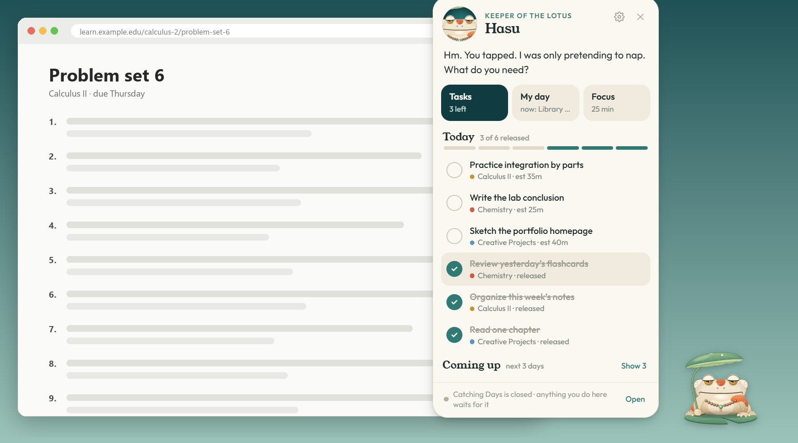
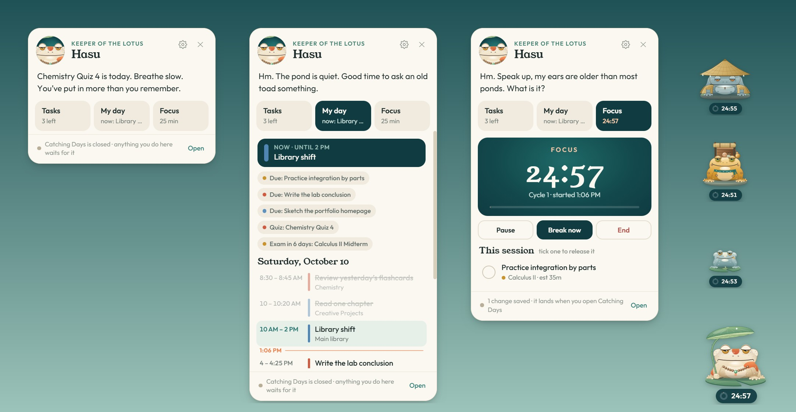

# Desktop toad

An optional add-on for Catching Days: one of the pond's nine toads lives on your desktop, on top of your other windows, so you never have to open the app to tick something off.



- **Drag it anywhere.** It stays where you leave it.
- **Push it against the left, right or bottom edge of the screen** and it hides there with only its head peeking out (at the bottom it sinks until just its eyes are above the line, like a toad in a pond). Drag it back out to see all of it.
- **Tap it** and it says something, then gives you four places:
  - **Tasks**: add a task (for today, tomorrow, a day you pick on a little calendar, or no date, in one of your classes if you like), then today's list, what's waiting in the reeds, and what's coming up in the next 3 days (habits only for tomorrow, so the week's repeats don't crowd it). Tick one and it's released into the pond.
  - **My day**: your Calendar tab's timeline for today, what's on now and what's next, plus deadlines and tests coming up.
  - **Notes**: jot a sticky note and it sticks to your desktop. It's one of the app's own sticky notes (Journal · Sticky notes), so it's kept there too. The notes afloat are listed here: put any of them on the desktop, take it off, or settle it.
  - **Focus**: the toad comes out to the middle of your screen and asks, in its own way, whether you're ready and mean it (pick Gentle, Classic, Deep or your usual rhythm right there). Say yes and it answers, counts down 3, 2, 1, starts the session, and slithers off into a bottom corner with the timer under it. Say not yet and it goes back where it was. It rings the bell when the block is done, and you can rate the block, take your break, and save the session without leaving what you're doing. "Pick tasks first" opens a set-up where you can bring tasks into the session.
- **Sticky notes on the desktop**: drag one by its top strip, resize it from its edges, write in it (it saves a moment after you stop), change its colour, keep it on top of other windows, or settle it when you're done with it. **+** (or Ctrl+N) makes a new one. Taking a note off the desktop doesn't delete it; it stays in the app. Notes you leave on the desktop come back where they were when the toad starts again.
- **Reminders**: between focus sessions, every 45 minutes you haven't touched the toad (8 AM to 10 PM), it hops, pings softly and quietly opens its talk box with one thing to do, in its own voice: what's next on your planner, a test coming up, today's most pressing task, one from the reeds, tomorrow's (from 3 PM), or the minutes left to your focus goal. It rotates so it doesn't nag about the same thing, and the box closes by itself if you leave it. Never during a session. Change the gap (Off, 30m, 45m, 1h, 2h) in the talk box's settings or right-click → Reminders.
- **Check-ups**: every 30 minutes the toad asks what you're up to, a different way each time and in its own voice. Type a line and it answers back, then keeps it in your Journal: one **Check-ins** page a day, a line for each answer with the time. It only asks while you're at the computer (it waits while you're away or locked and asks when you're back), never during a running focus block or while the talk box is open, and an unanswered question goes away by itself after a few minutes. Change how often (15 minutes to 2 hours, or off) in the toad's settings or from the right-click menu, which also has **Check in now**.
- **Smart replies, no internet and no AI service**: the toad reads what you wrote for what you actually did, not for single words. "Instead of doom scrolling, I hit the gym" is a good choice and gets praised; "I should be studying but I'm on TikTok" gets a nudge, not a scolding; "was going to study but I napped" counts the rest. It knows dozens of activities (study, work, exercise, chores, food, rest, people, scrolling, watching, gaming), "instead of", "but", "then", "not", "should", "about to", "finished", "trying", and how you say you feel, and each of the nine toads answers in its own way.
- **Every toad has its own talk, and a lot of it**: about 600 check-up lines each, over 5,600 in all, and no two toads share a line. Each one asks differently in the morning, afternoon and evening, late at night, on weekends, at your first check-in of the day, when you're back from being away and on a focus break, and sometimes picks up from your last answer ("Last time it was TikTok. Where are you now?"). Two good answers in a row get noticed. Its answers often add a line about the thing itself: the gym, laundry, math, science, languages, history, music and art each get their own remarks, a line about the piano never answers the guitar, and putting the phone down gets a different one from picking it up. The toad won't repeat a line it said recently.
- **Right-click the toad** for **New task…** and **New sticky note** straight away.
- **Choose your toad**: Hasu, Ame, Sumi, Tabi, Hotaru, Neri, Oto, Kuri or Mame. Each one talks in its own voice. Right-click the toad (or use the tray icon) for the chooser, the size, and Start with Windows.



<sub>Captures use fictional sample data.</sub>

## Install (Windows)

You need [Node.js](https://nodejs.org) and Catching Days running from its local server (`Start Catching Days.bat`).

1. Keep this `desktop-pet` folder inside your Catching Days folder.
2. Double-click **Install Desktop Toad.bat**. It downloads Electron (about 100 MB, once), adds a **Catching Days Toad** shortcut to your Start menu, starts the toad, and sets it to start with Windows. You can turn that off from the toad's settings.

Or by hand, in a terminal in this folder:

```bash
npm install
npm start
```

If the toad can't find Catching Days next to it, it asks you to pick the folder that has `focus-data.json` in it.

## How it works with your data

The toad never writes your save file. It reads `focus-data.json`, and puts what you do on it (a tick, a session started, a block rated, a check-up answered) into `desktop-pet-inbox.json` next to it. The app, through `desktop-pet-link.js`, takes each one in with its own functions, so a task ticked on the desktop releases its fish, a task or a sticky note made there is made the way the app makes one, and a session started there is saved with its cycles, exactly as if you'd done it in the app. Each action is stamped with the moment you did it.

- **App open:** it lands at once, even if the app's tab is in the background. If the session would need one of the app's dialogs while you have another dialog open, it waits for you to close yours.
- **App closed:** it waits in the inbox, the toad shows it as done in the meantime, and it lands the next time you open the app.

The toad also listens on `127.0.0.1` (a port from 8771 up) so the open app can hear about each action right away. Nothing is reachable from outside your computer.

## Files

```text
main.js          the toad's windows, dragging and edge peeking, the inbox, the bell, when to check up
core.js          reads the pond: today's list, the reeds, the do-score, the day, the session clock
pet.js / .css    the toad on the desktop (art loaded from the app's own toad files)
panel.js / .css  the talk box: chat, tasks, the day, focus, check-ups
stage.js / .css  the focus ritual: the toad in the middle of the screen, 3, 2, 1, off to a corner
note.js / .css   a sticky note on the desktop
pet-lines.js     what each of the nine toads says
checkin.js       reads a check-up answer: what you did, what you skipped or put off, how you feel
checkin-lines/   each toad's check-up questions, replies and topic lines, one file per toad
preload.js       the bridge between the windows and the rest
test/            node tests for core.js and checkin.js; voice-shape.js checks a toad's lines file
```

`desktop-pet-link.js` lives in the app folder, beside `catching-days.html`, which loads it. Without the toad it does nothing.

## Input regression checks

Run `npm run test:input -- --art-dir="C:\path\to\Catching Days"` to check dragging
for all nine toads at all three sizes, edge peeking, interrupted mouse presses,
and returning from the focus prompt. This opens a separate Electron instance
with disposable settings and sample data; it reads only the artwork from the
specified folder. Results are written to `test/last-run.log`.
